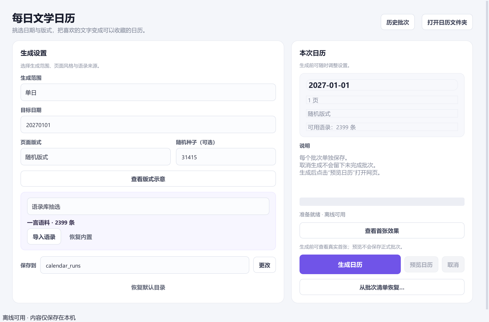
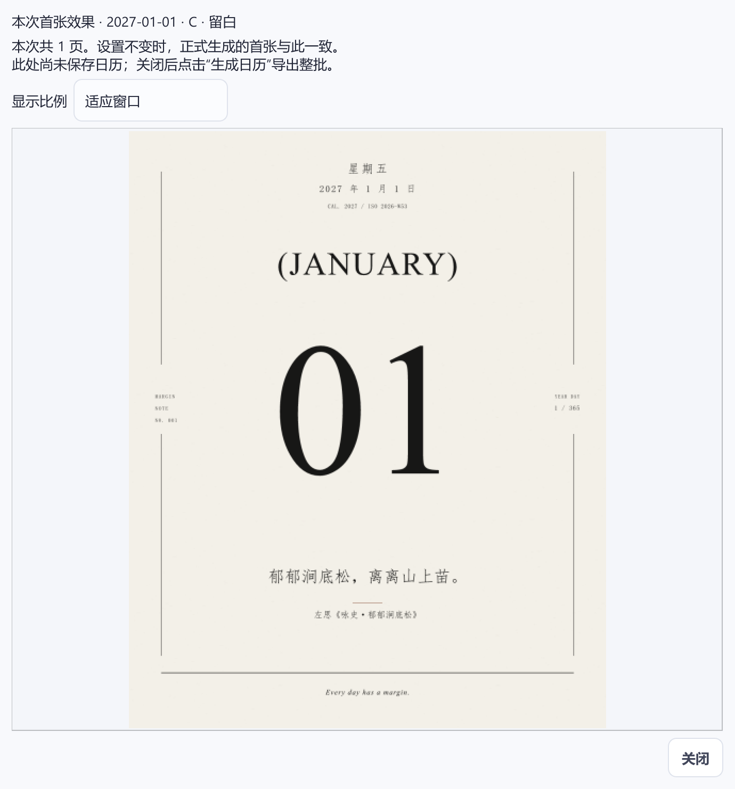
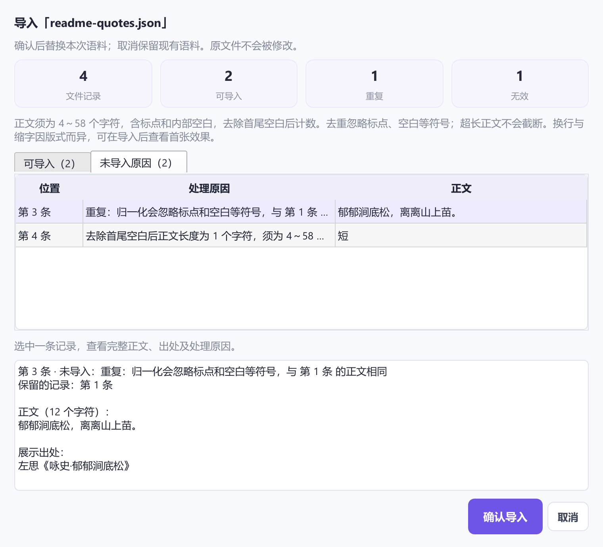
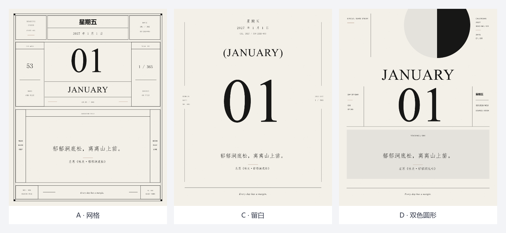
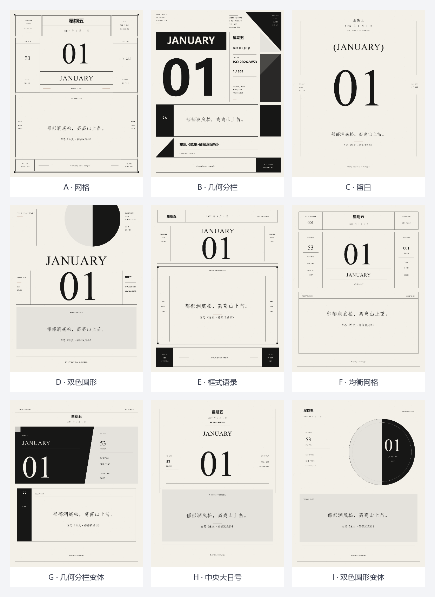

# 每日文学日历 · Calendar Workflow

[](https://github.com/QDxjs/calendar-workflow/actions/workflows/ci.yml)
[](https://github.com/QDxjs/calendar-workflow/releases/latest)
[](LICENSE)

离线生成每日文学日历的 Windows 桌面工具。选择单日、日期范围、周、月或年，使用九种版式导出 **1122 × 1402** 的 PNG、可编辑 SVG、离线网页预览和可恢复的批次清单。当前版本：**0.6.2**。

## 软件界面与生成效果

### 桌面界面

在一个窗口内选择生成范围、页面版式、语录来源和保存位置，再点击“生成日历”。下图是 **0.6.2** 的实际桌面组件，展示“查看版式示意”和“查看首张效果”入口，使用演示日期与通用保存目录。Windows EXE、窗口和任务栏使用[原创日历与书页图标](assets/calendar.png)。



<details>
<summary>展开查看 0.6.2 的首张预览与语料导入诊断</summary>

“查看首张效果”在导出前展示本次首张；内容设置不变时，正式导出的首张与预览一致。下例导入左思诗句并选择 C · 留白版式，尚未保存正式批次。



导入确认先展示可用、重复和无效记录数，再按原始位置列出正文、出处和处理原因。下例使用专门准备的古诗文演示数据，包含两条可导入记录、一条重复记录和一条过短记录；选中的重复项在下方显示完整详情。



</details>

### 生成结果

以下图片由 **0.6.2** 实际导出。下图展示 **A · 网格、C · 留白、D · 双色圆形**，使用同一天和同一段古诗，方便比较版式。PNG 原图为 1122 × 1402，同时可导出 SVG。



[查看单页原尺寸 PNG](docs/images/calendar-single.png) · [查看九种版式大图](docs/images/all-layouts.png)

<details>
<summary>展开查看 A–I 全部九种版式</summary>



</details>

示例诗句为左思《咏史·郁郁涧底松》的“郁郁涧底松，离离山上苗。”；示例输入与图片来源见 [图片说明](docs/images/README.md)。

## 直接使用

1. 在 [Releases](https://github.com/QDxjs/calendar-workflow/releases/latest) 下载 `CalendarWorkflow-版本号-windows-x64.zip`。
2. 完整解压，双击 `CalendarWorkflow.exe`。无需安装 Python，也无需联网。若默认保存位置不可写，仍可进入主界面并按提示另选目录。
3. 选择生成范围、版式与语录来源。用“查看版式示意”可滚动比较并选用 A–I 九种版式；用“查看首张效果”可在生成前核对当前设置下的首张。导入 JSON／JSONL 时，可先在只读诊断表中检查可导入记录和未导入原因。
4. 选择保存位置，点击“生成日历”。生成期间设置暂时锁定，摘要保持为本次任务的内容。任务结束后可以继续编辑；失败时可按提示修正后重试。
5. 生成成功后手动点击“预览日历”打开批次网页。新任务取消或失败后，仍可查看上次成功的批次网页。

请保留 EXE、`_internal/` 和 `Documentation/` 的完整结构。发行页的 **Source code** 是开发源码；普通 Windows 用户应下载上述便携 ZIP。详细操作见 [USER_GUIDE.md](USER_GUIDE.md)。

## 功能

- 0.6.2 单日手写允许正文和出处留空，生成留白日历；只含标点仍会提示修改。空白页与仅出处页支持九种版式导出及清单恢复。
- 0.6.1 新增“单日手写”：输入多行正文与可选出处，实时字数与字段校验；超过 58 字仅提醒，随机版式在九种实际 SVG 试排通过的候选中抽选。手写不改变语料库，切换多日自动回到语录库，草稿仅在本次打开期间保留。
- 手写沿用首张预览、原子导出与清单恢复，内部换行和空出处无损保存；视觉断行仍由当前模板平衡。历史清单改为单次解析，详情展示本地“清单更新时间”，不推断生成时间。
- 0.6.0 新增“历史批次”：重启后扫描当前保存位置，也可另选历史位置，打开批次网页/目录或恢复到新目录；缺失网页、缺图与清单错误分别提示，查看不改原文件。
- 便携版与源码版均记住用户显式选择的保存目录；“恢复默认目录”清除覆盖，默认位置继续随当前程序位置计算。
- 新生成的离线网页支持大图灯箱、左右键翻页、Esc 关闭、适应窗口/原始尺寸及按年月组合筛选。旧批次网页保持原样，可用清单恢复生成新版网页。
- B/E 年份和 A–E 日相关编号随实际日期更新；日编号采用三位年积日，版式 B 的版本号/系列号保持原意。
- 切换日期模式时同步更新输入框与格式提示，回到已填写过的模式会恢复原输入。
- 九种 SVG 版式 A–I，可指定一种，也可随机抽选；随机模式尽量避免相邻日期版式相同。
- 版式示意用同一段内置示例文字渲染缩略图。首张效果与随后生成共用整个范围的内容计划，内容设置不变时首张一致，包括随机版式且未填种子的情况。只改保存位置不影响计划；失败或取消可沿用计划重试，成功后清除本批计划。未填种子时下一批重新抽选，不保证跨批去重；固定种子配合相同参数和语料可复现抽选。
- 本地 Hitokoto b/d/h/k 语料固定版本，保留出处及 UUID；同批次内语录正文不重复。
- 导入自己的 UTF-8 JSON／JSONL 语料。在只读虚拟表格的“可导入”页核对正文与最终展示出处，在“未导入原因”页查看无效或重复记录；选中记录可看完整详情。无可导入记录时只能查看诊断；取消保留当前语料，确认后才替换本次运行中的语料，不修改源文件。
- 桌面导入正文去除首尾空白后须为 4–58 个字符，计入标点和内部空白；正文不会截断，出处单独处理。固定版式框使用估算宽度换行、均衡行长，必要时缩小字号；这不是字体精测或碰撞检测，诗歌分行和特殊符号应实际查看首张效果。
- 生成 SVG、PNG、`index.html` 和 `manifest.csv`；网页支持离线搜索、版式筛选与单页下载。
- 按清单恢复内容和实际版式；生成前预检，失败或取消时清理暂存文件，拒绝覆盖已有批次。
- 包内文件哈希校验，以及随发行包保留的第三方许可和构建依赖记录。

## 从源码运行

当前完整桌面及 PNG 流程面向 **Windows x64**。建议 Python **3.12**，CI 同时检查 3.10 和 3.12。随附 PNG 渲染器是 Windows 可执行文件，尚未验收 macOS / Linux。

```powershell
git clone https://github.com/QDxjs/calendar-workflow.git
cd calendar-workflow
python -m venv .venv
.\.venv\Scripts\python.exe -m pip install -r requirements.txt
.\.venv\Scripts\python.exe launcher.py --desktop
```

无需激活虚拟环境即可使用上述命令。首次安装依赖需要联网；安装完成后的日历生成使用本地文件。

终端菜单：`.\.venv\Scripts\python.exe launcher.py --console`。源码版不带参数运行 `launcher.py` 时也进入终端菜单；桌面界面请明确使用 `--desktop`。

手动 CSV 预检及生成：

```powershell
.\.venv\Scripts\python.exe generate.py --input content.csv --check
.\.venv\Scripts\python.exe generate.py --input content.csv --seed 31415
```

CSV 必须包含唯一表头 `date,quote,source,layout`，日期使用 `YYYY-MM-DD`；正文或出处含逗号时请按 CSV 规则加双引号。版式可填 A–I，或填 `R` / `auto` / 留空以随机选择。预检不生成 PNG，也不写出批次。

内置语料与 JSON／JSONL 语料库（包括命令行 `--quotes`）共用 4–58 字符筛选；CLI CSV 或既有 manifest 没有统一的 58 字上限，继续按原有处理方式校验与恢复。

## 输出与恢复

便携版默认保存到 EXE 同目录的 `calendar_runs/`；源码版默认保存到 `output/calendar_runs/`。更改后会记住用户选择，点击“恢复默认目录”可清除覆盖。程序在生成前检查保存位置是否可写；若检查未通过，请在界面改选可写目录，程序不会自动换目录。每次生成一个独立批次：

```text
批次目录/
├── svg/2027-01-01_layout-C.svg
├── png/2027-01-01_layout-C.png
├── index.html
└── manifest.csv
```

清单记录日期、ISO 周、实际版式、语录、出处、UUID、种子及程序版本。桌面版可点击“从批次清单恢复…”；命令行示例：

```powershell
.\.venv\Scripts\python.exe generate.py --replay .\某个批次\manifest.csv --outdir .\restored-batch
```

恢复目录必须尚未存在。恢复使用当前模板、字体和渲染器；如需保存原始像素效果，请同时备份原图片。

## 检查与构建

```powershell
.\.venv\Scripts\python.exe tools/check_project.py
.\.venv\Scripts\python.exe -m unittest discover -s tests -v
.\.venv\Scripts\python.exe -m pip install -r requirements-build.txt
$env:PATH = "$PWD\.venv\Scripts;$env:PATH"
.\build_portable.ps1
```

构建脚本在临时目录打包，收集许可并自检九种版式示意、首张一致性、单页生成及清单恢复的取消和重试，通过后才生成 `dist/CalendarWorkflow/`，已有目录不会被覆盖。发布版本标签会触发 GitHub Actions，自动构建便携 ZIP、校验文件并创建 Release。具体步骤见 [RELEASE_HANDOFF.md](RELEASE_HANDOFF.md)。

## 开源与维护

原创代码和文档采用 [MIT](LICENSE)，版权人为青灯。特别感谢 [Hitokoto 一言开源社区](https://github.com/hitokoto-osc/sentences-bundle) 和 [resvg](https://github.com/linebender/resvg)。第三方组件的许可边界见 [THIRD_PARTY_NOTICES.md](THIRD_PARTY_NOTICES.md)。

内置语料来自固定版本的漫画（b）、文学（d）、影视（h）、哲学（k）四类，共 2,631 条原始记录；筛选、去重后当前有 2,399 条可用记录。上游声明 AGPL-3.0，同时提示并不拥有所有句子的著作权。**本项目 MIT 不会额外授予语料或单条句子的使用权。** 来源、固定提交与随附许可见 [HITOKOTO_SOURCE.md](HITOKOTO_SOURCE.md) 和 `data/hitokoto/`；公开或商业再分发前请核对相应内容权利。

- 不熟悉 GitHub 维护：先看 [MAINTENANCE.md](MAINTENANCE.md)。
- 报告问题或建议：[Issues](https://github.com/QDxjs/calendar-workflow/issues)。
- 参与修改：[CONTRIBUTING.md](CONTRIBUTING.md)；安全问题：[SECURITY.md](SECURITY.md)。
- 版本变化：[CHANGELOG.md](CHANGELOG.md)；后续方向：[ROADMAP.md](ROADMAP.md)。
